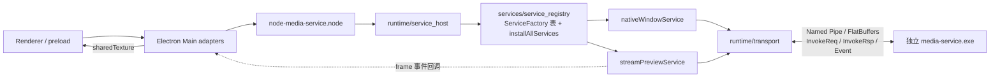

# node-media-service

Electron Main 加载的业务 Node-API 模块。每次 `createMediaService()` 创建独立实例：启动 `media-service.exe`、连接 Named Pipe、完成 Session 握手，然后在 root 上挂出全部服务对象。服务对象与事件订阅由 `core/schemas/generate.py` 从 `core/schemas/*_service.fbs` 生成，`runtime/service_host` 只负责进程/管道/握手/状态生命周期，不感知具体服务。



`BrowserWindow`、`WebContents`、页面权限校验和 `sharedTexture` 导入/发送由 Electron 持有。addon 接收 HWND、ID、矩形等普通值，通过服务代理转发给 media-service；窗口/预览业务状态在服务端 Service 里，addon 不维护 key→id 之类的门面。

## 目录职责

```text
core/node-media-service/
|-- CMakeLists.txt
|-- README.md
|-- index.d.ts
|-- src/
    |-- addon.cpp
    |-- runtime/
    |   |-- napi_util.h
    |   |-- napi_util.cpp
    |   |-- service_host.h
    |   |-- service_host.cpp
    |   |-- transport.h
    |   |-- transport.cpp
    |-- services/
    |   |-- service_proxy.h
    |   |-- service_registry.h
    |   |-- service_registry.cpp
    |   |-- native_window_service.h/.cpp
    |   |-- stream_preview_service.h/.cpp
    |-- texture-handle/
        |-- texture_handle.h
        |-- texture_handle.cpp
```

| 目录/文件 | 职责 |
| --- | --- |
| `src/addon.cpp` | 稳定 Node-API 模块入口，解析 options → ServiceHost |
| `src/runtime/` | 进程/管道/握手/状态生命周期（service_host）、消息收发（transport）、N-API 工具（napi_util） |
| `src/services/` | 生成的同名服务映射 + 统一注册表（service_registry） |
| `src/texture-handle/` | 纹理句柄桥（原 node-streampreview 独立 addon） |
| `index.d.ts` | 公开业务类型，构建时随 `.node` 分发 |

## 服务与事件规则（生成器约定）

- **服务注册**：`core/schemas/generate.py` 为每个 `core/schemas/*_service.fbs` 生成同名 `*Service` 代理（`ServiceProxy` 子类，`serviceId()` = 类名），并产出 `services/service_registry.{h,cpp}`：一个 `ServiceFactory` 工厂表 + `installAllServices()`。新增服务只需新增 fbs + 一行登记，`service_host` 不再叠加。
- **挂载**：root 属性名 = `camel(serviceId)`（如 `NativeWindowService` → `nativeWindowService`）；服务对象方法 = 该服务的 invoke 方法（返回 Promise）。
- **事件订阅**：`XxxEvent` 表（必须是 root_type）= 一个事件，事件名 = 去掉 `Event` 后缀的 camelCase（`FrameEvent` → `"frame"`）。生成器为每个事件产出 `subscribeXxx(callback)`（返回 `{ dispose() }`，单监听者、dispose 反注册）、`unsubscribeXxx` 与 `dispatchXxx`；payload 解码为 JS 对象，`ulong` 字段为 `bigint`（如 `token`），名为 `handle` 的 `ulong` 字段由 `napi_util::handleBuffer` 复制为本进程句柄 Buffer。
- **帧归还（方案 B）**：事件对象不附带自动归还逻辑；业务方消费完 `frame.handle` 后调用 `streamPreviewService.releaseVideoFrame(frame.id, frame.token)`。句柄复制失败时 `handle` 为 `undefined`，同样由业务方归还。

## 公开调用

```js
const { createMediaService } = require('./node-media-service.node');
const service = createMediaService({
  executable: 'F:/path/media-service.exe',
  logPath: 'F:/path/logs/media-service.log',
  startupTimeoutMs: 10000,
});
const statusSub = service.subscribeStatus(value => console.log(value));
await service.initialize();

// host 是 Electron BrowserWindow.getNativeWindowHandle() 转换出的 bigint HWND；id 由业务分配。
await service.nativeWindowService.create(1, host, true);
await service.nativeWindowService.setRect(1, { x: 20, y: 40, width: 640, height: 360 });
await service.nativeWindowService.setVisible(1, true);

await service.streamPreviewService.createStreamPreview(7);
const frameSub = service.streamPreviewService.subscribeFrame(frame => {
  // frame.handle 是本进程 Buffer HANDLE；导入 Electron 后消费完毕必须归还帧。
  importTexture(frame.handle, frame.width, frame.height, frame.timestampUs);
  service.streamPreviewService.releaseVideoFrame(frame.id, frame.token);
});
frameSub.dispose(); // 幂等；反注册 frame 事件

await service.nativeWindowService.releaseAll();
statusSub.dispose();
await service.stop(); // 终止子进程并断开连接
```

参数错误同步抛出；执行失败、超时和断开拒绝 Promise。`subscribeStatus` 返回 `{ dispose() }`，状态快照包含 `connected/message/phase/pid/session/nativeClose`，可安全转为 JSON。

## 构建与复验

从仓库根执行：

```powershell
python core/schemas/generate.py --check
python scripts/build.py --config Debug --generator "Visual Studio 17 2022" --toolset v143
```

`generate.py` 的生成物（`core/common/protos/*.h` 与 `core/node-media-service/src/services/*`）已 check-in，`--check` 幂等校验；CMake 的 `generate-schemas` 目标构建时重跑生成。
